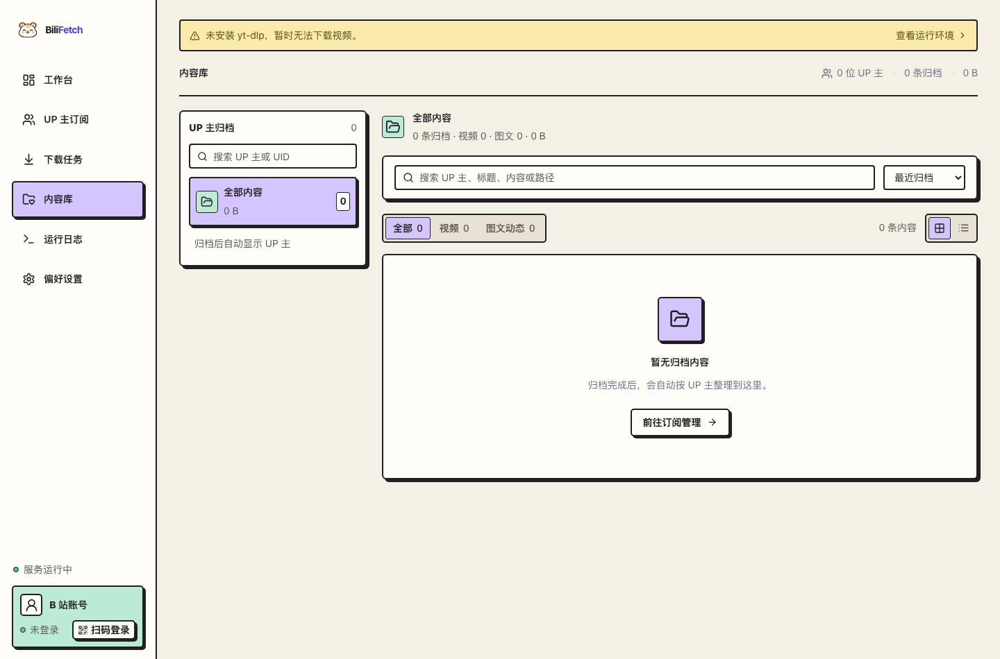
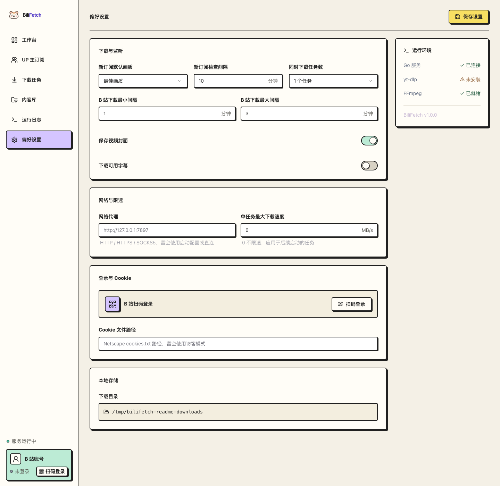

# BiliFetch

BiliFetch 是一个自托管的内容归档工具。添加 Bilibili 或小红书创作者后，应用会定期检查更新，并将视频与图文保存到本机。网页关闭后，后台服务仍会继续运行。

## 界面截图

| 页面 | 说明 | 截图 |
| --- | --- | --- |
| 内容库 | 当前工作区尚无归档内容 |  |
| 偏好设置 | 展示下载、网络、登录和本地存储选项 |  |

## 功能

- 订阅 Bilibili、小红书创作者，设置检查间隔、视频画质和监听内容。
- 下载视频与图文，查看任务进度；失败任务可以重新尝试。
- 按订阅拉取较早的视频和图文，支持暂停、继续，并跳过已有任务。
- 在内容库搜索、筛选和预览归档内容，也可以下载图文压缩包。
- 查看服务资源使用情况和运行日志。

## 部署

### 本机运行

需要 Go 1.24 或更新版本、Node.js 22、Python 3.10 或更新版本，以及 FFmpeg。macOS 可以运行：

```sh
brew install go node@22 ffmpeg
make install
make install-ytdlp
make install-xhs-api
make build
make run
```

打开 [http://127.0.0.1:8090](http://127.0.0.1:8090)。

开发时，在两个终端分别运行 `make dev-server` 和 `make dev-web`，然后打开 [http://127.0.0.1:5173](http://127.0.0.1:5173)。

### Docker

需要安装 Docker Compose。运行：

```sh
docker compose up -d --build
```

打开 [http://127.0.0.1:8090](http://127.0.0.1:8090)。应用状态和下载文件保存在 Docker 命名卷中。导出下载文件：

```sh
docker compose cp bilifetch:/app/downloads ./downloads-backup
```

默认只允许本机访问。远程访问前，请配置带有身份验证的反向代理。

## 使用

1. 在「平台管理」扫码登录对应平台，凭据加密保存在本地状态数据库中。
2. 打开「创作者订阅」，选择平台后输入 Bilibili UID、小红书号、App 分享短链或完整主页链接。
3. 选择要监听的视频或图文，设置检查间隔、画质，以及是否归档最近发布的内容。在「偏好设置」调整网络代理与下载并发数。
4. 在「下载任务」查看进度，在「内容库」搜索和预览已归档内容。

首次扫描会建立内容基线。选择归档最近内容后，应用会将平台可访问的近期内容加入下载队列。需要补充较早内容时，可在订阅卡片中启动「拉取历史」。

小红书账号解析与笔记列表通过 [Spider_XHS](https://github.com/cv-cat/Spider_XHS) 的 HTTP 接口和本地签名算法执行，不启动浏览器；浏览器仅用于主动扫码登录。API 依赖独立安装在 `.tools/xhs-api`，不依赖 MVP 代码。添加订阅只要求本地存在可读取的登录凭据，实际请求遇到登录失效或平台验证时会显示对应错误。

## 数据与配置

默认情况下，服务地址为 `127.0.0.1:8090`，状态保存在 `./data`，归档文件保存在 `./downloads`。可通过环境变量调整：

| 环境变量 | 默认值 | 用途 |
| --- | --- | --- |
| `BILIFETCH_ADDR` | `127.0.0.1:8090` | 服务监听地址 |
| `BILIFETCH_DATA` | `./data` | 状态与登录数据目录 |
| `BILIFETCH_DOWNLOADS` | `./downloads` | 视频与图文保存目录 |
| `BILIFETCH_WEB` | `./web/dist` | 网页文件目录 |
| `BILIFETCH_PROXY` | 空 | 默认网络代理地址 |
| `BILIFETCH_YTDLP` | `yt-dlp` | yt-dlp 程序路径 |
| `BILIFETCH_XHS_RUNTIME` | `./.tools/xhs-api` | 小红书 HTTP API 的 Python、Node 与 Spider_XHS 运行目录 |

请定期备份状态目录和下载目录。当前应用面向单用户运行，请勿让多个服务进程同时使用同一状态目录。

请只归档有权保存的内容，并遵守相关平台的使用规则。
